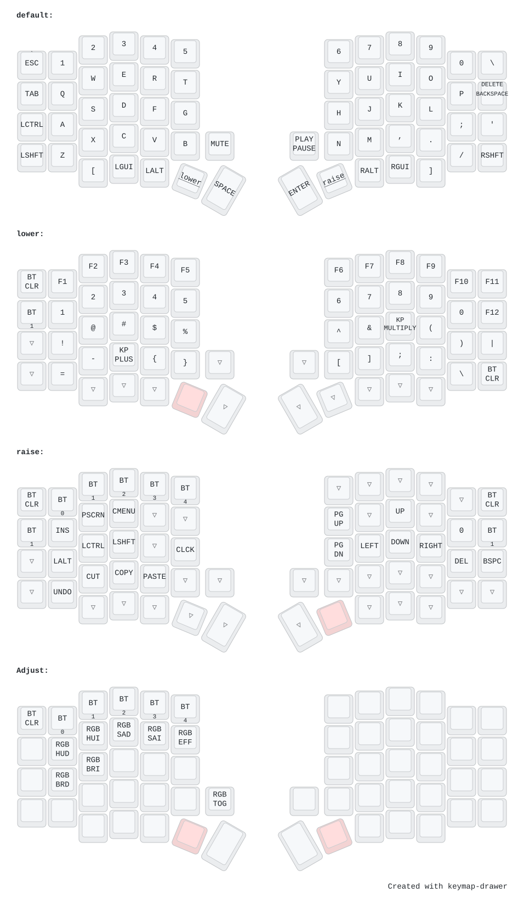

# ZMK Config for Sofle Keyboard

## Overview

Configuration for Sofle V2 keyboard with mouse support, Oled Support and more. 

## Features

- **Custom Key Mappings**: 
    - Added Mouse Support
    - Added Grave Escape & Backspace Delete
    - 
- **Layer Support**: 
    - Mouse Layers
    - Conditional Adjust Layer

## Hardware / firmware layout

- **Dongle**: Seeed XIAO nRF52840 (BLE) + Prospector display. Central, USB to the PC. Shield: `sofle_dongle prospector_adapter`.
- **Left / right halves**: nice!nano v2, both **peripherals**. Shields: `sofle_left`, `sofle_right`.
- ZMK is pinned to **v0.3** (Zephyr 3.5), so board names are the old style (`seeeduino_xiao_ble`, `nice_nano_v2`).

### Flashing order
1. Flash `settings_reset` to every device once (dongle and both halves), if they were paired before.
2. Flash the dongle, then the left half, then the right half.
3. Pair the **left half first, then the right** (the Prospector battery widget orders them by pairing order).

## Keyboard Layout

## Acknowledgments

- [Kim (infused-kim)](https://github.com/infused-kim)
- [Rafael Romão (rafaelromao)](https://github.com/rafaelromao)
- [Cem Aksoylar (caksoylar)](https://keymap-drawer.streamlit.app)
- [Robert U (urob)](https://github.com/urob/zmk-config)
- [Pete Johnson (petejohnson)](https://github.com/petejohanson)
- [Stas Prokofyev (proostas)](https://github.com/proostas)
- [ZMK Documentation](https://zmk.dev/)
- [ZMK Discord](https://github.com/zmkfirmware/zmk)
